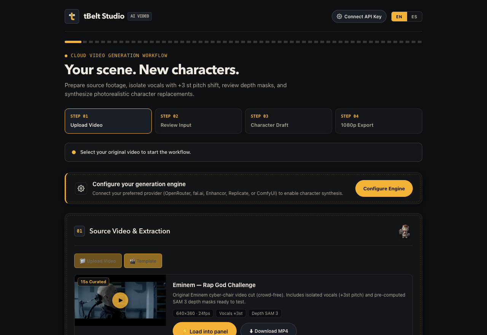
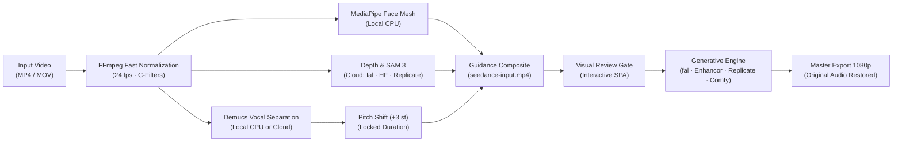

# tBelt Studio

> **Motion-guided character replacement and video recasting with original audio preservation.**

[](LICENSE)
[](https://python.org)
[](providers.py)
[](docs/DEPLOY-WEB.md)
[](static/i18n.js)

**tBelt Studio** is an open-source pipeline for photorealistic character replacement and motion transfer in video. It operates flexibly across two execution models:
- **Hybrid Local-First (Default)**: High-speed local CPU signal processing (FFmpeg normalization, MediaPipe 3D face mesh, Demucs vocal isolation) paired with cloud or local neural synthesis engines.
- **100% Cloud & Web-Only**: Fully containerized ([`Dockerfile`](Dockerfile)) for deployment on free Hugging Face Spaces (CPU Basic tier), Railway, Render, or VPS. Offloads both signal isolation (cloud Demucs API) and volumetric masking (Hugging Face ZeroGPU / fal.ai) to cloud services, running end-to-end in the browser with zero local hardware or software dependencies.

The entire source audio (dialogue, music bed, sound effects) is preserved and remuxed into the final export, while actor movement, facial expression, and lip-sync are transferred onto a new identity.

<p align="center">
  
</p>

---

## Quick Navigation

- [Curated Motion Templates (Zero-Wait Testing)](#curated-motion-templates-zero-wait-testing)
- [Bring Your Own Token (BYOK & Guest Mode)](#bring-your-own-token-byok--byot--guest-mode)
- [Model Requirements & Provider Matrix](#model-requirements--provider-matrix)
- [Workflow Architecture](#workflow-architecture)
- [Resource & Performance Profile](#resource--performance-profile)
- [Local Installation & Launch](#installation)
- [Cloud & Web-Only Deployment](#web--cloud-deployment)
- [Command Line Interface (CLI)](#command-line-interface-cli)
- [Web UI Walkthrough](#step-by-step-usage-web-ui)

---

## Core Engineering Highlights

tBelt Studio combines lightweight local signal processing with cloud and local neural diffusion engines:

### Curated Motion Templates (Zero-Wait Testing)

Templates allow testing character recasting in under 50 milliseconds without waiting for video normalization, SAM 3 depth extraction, or Demucs vocal isolation.

- **How to access in the UI**: In **Step 01**, click the **Template** tab (or **Plantilla** in Spanish) alongside "Upload Video".
- **Instant load card**: Click anywhere on the *Eminem — Rap God Challenge* card to provision an active session in `runs/<id>/`.
- **Pre-computed asset set**:
  - 15 seconds across 7 curated scenes, optimized for motion transfer and rapid speech articulation.
  - Isolated vocal stems modulated by +3 semitones to clear commercial Content ID audio filters.
  - Pre-approved SAM 3 depth and silhouette guidance masks.
  - Target identity reference: demo character `vc-chicken` with full comparison output.
- **Engineering documentation**: Read the [Motion Curation & Template Engineering Guide](docs/TEMPLATES.md) for scene selection rules and metadata specifications.

### Bring Your Own Token (BYOK / BYOT) & Guest Mode

tBelt Studio operates on an ephemeral, zero-trust credential model. Users connect directly to wholesale provider APIs without subscription lock-in or sharing credentials with the server host.

- **How to access in the UI**: Click the **Settings** button in the top navigation bar or click the **Connect API Key** badge.
- **Zero disk persistence**: Keys entered in the Settings modal remain in browser storage (`sessionStorage` or `localStorage`) and travel per-request via `X-AI-Key` HTTP headers directly into backend RAM. They are never written to `.env`, disk files, or database rows.
- **Configurable TTL**: Choose between **Session Only** (purged when the tab closes), **1 Hour**, **6 Hours**, or **24 Hours**.
- **Pure Guest Mode**: When hosted without keys in `.env`, any visitor or team member can run generations by supplying their own token at zero cost to the server host.
- **Supported engines**: OpenRouter (Alibaba Wan 3.0 / Wan 2.1 & ByteDance Seedance 2.5), fal.ai (Wan 2.2 & MiniMax Recast), Replicate, and local ComfyUI.
- **Architecture documentation**: Read the [BYOK Security Architecture Specification](docs/ARCHITECTURE.md#5-security-architecture-bring-your-own-token-byok--byot) for the wire protocol, sequence diagram, and credential hierarchy.

### Core Architecture & Signal Highlights

1. **Dual-Mode Signal Engine (Hybrid Local-First or Cloud-Only)**:
   - **Local CPU Mode**: Preparation runs locally on consumer CPU hardware (benchmarked on 8 GB Apple Silicon Mac mini). Video normalization runs via FFmpeg C-filters in under 3 seconds, Demucs (`htdemucs`) separates vocal stems locally, and MediaPipe processes 3D landmarks in real time with ~1.1 GB RAM footprint and zero preparation API billing.
   - **Web-Only / Cloud-Only Mode**: When deployed via Docker to cloud PaaS or free Hugging Face Spaces, preparation offloads audio isolation to Replicate's Demucs API and volumetric segmentation to Hugging Face ZeroGPU or fal.ai SAM 3, running in the browser without local Python or FFmpeg installation.

2. **Fault-Tolerant Motion & Facial Guidance**:
   - **Adaptive Multi-Face Tracking**: MediaPipe tracking calibrated for up to 4 simultaneous faces, stabilizing multi-monitor setups (e.g. CRT video walls) without dropping subjects.
   - **Temporal Occlusion Smoothing**: Interpolates landmark matrices across rapid head turns, yaw rotations, and temporary occlusions, guaranteeing continuous tracking without dropped frames.

3. **Studio-Grade Audio Engineering**:
   - Demucs isolates speech and music beds into uncompressed PCM stems.
   - Isolated dialogue is frequency-modulated by +3 semitones with duration locking via Rubber Band to eliminate vocal identity bleed while keeping syllable timing and lip-sync intact.
   - Guidance video embeds the modulated audio directly, and the final 1080p master export restores the complete original source mix (dialogue, score, sound effects).

4. **Production SPA & Operator Ergonomics**:
   - Asynchronous upload telemetry via `XMLHttpRequest` with exact byte counts and percentage indicators (`X.X MB / Y.Y MB`).
   - Active session stopwatch (`mm:ss`) and 4-phase milestone tracking (Normalization, Mesh/Depth, Audio Separation, Review Gate).
   - In-memory artifact manifest (`Set.has()`) for O(1) artifact existence verification, eliminating blind HTTP 404 network probing.
   - Bilingual UI with one-click toggling between Spanish (`es`) and English (`en`).

5. **Daemon & Security Hardening**:
   - Thread-safe background execution managed by `concurrent.futures.ThreadPoolExecutor` with clean lifecycle cleanup.
   - Centralized binary resolution (`find_binary`) automatically locates FFmpeg and Rubber Band paths across macOS `launchd` and Linux `systemd` environments.
   - Host credentials isolated in `.env` with `chmod 600` access controls; settings API returns boolean presence masks instead of plain-text tokens.

---

## Model Requirements & Provider Matrix

Step 03 requires video-to-video character replacement models with full-body identity transfer that accept a driving composite video alongside character reference assets, maintaining original camera framing, cuts, lighting, and motion choreography.

| Provider & Model | Pricing Structure | Estimated Cost (15s Clip) | Best For | Subscription Required? |
|---|---|---|---|---|
| **OpenRouter (Wan 3.0 / Wan 2.1)** | Pay-per-second / API credits | **$0.20 – $0.50 USD** | Alibaba Wan video generation & BYOK tokens | **No** (Direct API key) |
| **Replicate (Wan 2.2 / LivePortrait)** | Serverless GPU-seconds (~$0.0005–$0.001/s) | **$0.40 – $0.90 USD** | Scalable cloud rendering & Demucs API | **No** (Pay per second) |
| **Hugging Face Spaces (ZeroGPU)** | Free community GPU quota | **$0.00** | Free SAM 3 & Depth Anything | **No** (Free `HF_TOKEN`) |
| **Enhancor (ByteDance Seedance 2.5)** | Subscription credits (~$0.15–$0.35/draft) | **~$0.25 USD** (in credits) | High-volume production | **Yes** ($45/mo plan) |
| **fal.ai (Wan 2.2 / MiniMax H3 Max)** | Pay-as-you-go ($0.04–$0.45/s) | **$0.60 – $6.75 USD** | Pay-as-you-go test iterations | **No** (Prepaid balance) |
| **ComfyUI Local** | Self-hosted local GPU hardware | **$0.00** | Offline privacy & custom nodes | **No** (Free open weights) |

---

## Workflow Architecture



---

## Resource & Performance Profile

Benchmark tests performed on Apple Silicon M1 (8 GB RAM, 10s test clip):

| Pipeline Stage | Engine | Execution Time (10s Clip) | Peak RAM Consumption |
|---|---|---|---|
| **Video Normalization** | FFmpeg C-Filters | 2.5 seconds | ~80 MB |
| **Face Mesh Tracking** | MediaPipe (TFLite CPU) | 6.8 seconds | ~150 MB |
| **Vocal Isolation** | Demucs (`htdemucs` CPU) | 16.2 seconds | ~850 MB (peak) |
| **Pitch Modulation** | FFmpeg / Rubber Band | 1.1 seconds | ~40 MB |
| **Total Local Prep** | — | **~26.6 seconds** | **~1.1 GB max** |

---

## Quickstart

### Prerequisites
- macOS or Linux
- Python 3.12+
- `ffmpeg`, `rubberband`
- An API key for your chosen video engine (Replicate, Enhancor, or fal.ai) or a local ComfyUI URL.

```bash
# macOS (Homebrew)
brew install ffmpeg rubberband python@3.12

# Ubuntu / Debian
sudo apt update && sudo apt install -y ffmpeg rubberband-cli python3 python3-venv python3-pip
```

### Installation

```bash
# 1. Clone the repository
git clone https://github.com/tBeltty/studiotbelt.git
cd studiotbelt

# 2. Automated setup (creates .venv & installs dependencies)
bash setup.sh

# Or manual setup:
python3.12 -m venv .venv
source .venv/bin/activate
pip install -r requirements.txt
pip install -e .
cp .env.example .env
python -m studiotbelt.cli.doctor
```

### Running the Application

```bash
# Start studio launcher
bash start.sh
# Or directly via Python module:
python -m studiotbelt.cli.launch

# Or via installed console script:
studiotbelt

# Open in browser
open http://127.0.0.1:8770
```

### Setup via Coding Agent

To configure the environment using an agentic coding tool with terminal and filesystem access (Codex, Claude Code, Cursor, Antigravity), provide the following prompt:

```text
Set up this tBelt Studio project. Read docs/SETUP.md and follow it end to end. Detect my OS, install missing prerequisites (Python 3.12+, FFmpeg, Rubber Band, cloudflared) using the supported package manager, create the main virtual environment (.venv), install dependencies (pip install -r requirements.txt && pip install -e .), run bash setup-face-mesh.sh for local face mesh tracking if supported, and create .env from .env.example without overwriting existing keys. Run the local tests (python -m unittest discover tests) and environment diagnostics (python -m studiotbelt.cli.doctor). Launch the app and its callback-only tunnel via bash start.sh on a free localhost port, verify that the UI responds, and report the working URL. Work independently through setup, respecting system permission prompts. Do not submit paid generations. If API keys are missing, launch the UI and indicate which provider keys are pending.
```

The launcher initializes a callback-only Cloudflare Quick Tunnel when no custom webhook is configured. Keep it running alongside the application. The agent references the included [setup guide](docs/SETUP.md). Supply your own provider keys in `.env` and approve required system package installations. Windows users must run inside WSL2 (Ubuntu); launch scripts are included for macOS and Linux.

---

## Web & Cloud Deployment

To run tBelt Studio in the cloud without installing local dependencies:

1. **Hugging Face Spaces (Free)**:
   - Create a new Space at [huggingface.co/new-space](https://huggingface.co/new-space) selecting the **Docker** SDK (**CPU Basic Free** hardware tier).
   - Connect or push this repository.
   - Under Settings -> Secrets, configure `PORT=7860` and your credentials (`REPLICATE_API_TOKEN`, `ENHANCOR_API_KEY`, `FAL_KEY`, or `HF_TOKEN`).
2. **PaaS Providers (Railway, Render, Google Cloud Run)**:
   - Connect your GitHub repository. The included `Dockerfile` automatically builds and serves the application.
3. **VPS Server with Docker**:
   ```bash
   docker build -t studiotbelt .
   docker run -d -p 8770:8770 --env-file .env studiotbelt
   ```
4. **100% Cloud Processing (Zero Local Compute)**:
   - **Audio separation**: Configure `REPLICATE_API_TOKEN` to execute Demucs on Replicate GPU infrastructure.
   - **Depth and masks**: Use `huggingface` (free ZeroGPU via `HF_TOKEN`), `replicate`, or `fal`.
   - **Character synthesis**: Replicate, Enhancor, or fal.ai.

Refer to the complete technical guide in [docs/DEPLOY-WEB.md](docs/DEPLOY-WEB.md).

---

## Command Line Interface (CLI)

The package provides CLI entry points (`studiotbelt-workflow` or `python -m studiotbelt.core.workflow`) for headless execution and autonomous pipelines:

```bash
# 1. Prepare video (depth, face mesh, or depth+mesh)
python -m studiotbelt.core.workflow prepare path/to/source.mp4 --mode depth --provider auto
# Output: JOB: 8e5f2a1b4c3d... (32-character local job ID)

# 2. Check job status and obtain quality fingerprint
python -m studiotbelt.core.workflow status <JOB_ID>

# 3. Quality review gate (approve current motion/mask artifacts)
python -m studiotbelt.core.workflow review <JOB_ID> --approve --fingerprint <HASH> --note "Visual QA verified"

# 4. Submit character recast draft (supports --prompt string or --prompt-file)
python -m studiotbelt.core.workflow submit <JOB_ID> --prompt "A cinematic portrait of the character" --reference path/to/character.png
# Or with multiple character references:
python -m studiotbelt.core.workflow submit <JOB_ID> --prompt-file prompt.txt --reference char1.png --second-reference char2.png

# 5. Upgrade draft to high-definition 1080p
python -m studiotbelt.core.workflow hd <JOB_ID>

# 6. Resume pending or saved requests without re-paying
python -m studiotbelt.core.workflow resume <JOB_ID>
python -m studiotbelt.core.workflow resume <JOB_ID> --hd
```

---

## Step-by-Step Usage (Web UI)

1. **Step 01 — Choose Source Video or Template**:
   - **Custom Video Upload**: Drag and drop your source video clip (up to 30 seconds). Click **Prepare Video** to run normalization, depth/mesh tracking, and Demucs vocal isolation.
   - **Instant Curated Templates**: Switch to the **Template** tab (or **Plantilla** in Spanish) to test character transfer immediately without preparation wait times. Click the *Eminem — Rap God Challenge* card to load pre-calculated SAM 3 masks and +3st pitched vocals directly into your session in <50ms.
2. **Step 02 — Verification & Review Gate**:
   - Inspect the volumetric depth guide and isolated vocal stem (+3 semitones modulation to clear automated Content ID screening).
   - Verify or download isolated audio stems (`vocals.wav`, `vocals-plus3.wav`, `music.wav`).
   - Click **Approve & Continue to Character**.
3. **Step 03 — Character Synthesis & BYOK Credentials**:
   - Upload the target character reference image (such as the included `vc-chicken` avatar).
   - Enter your synthesis prompt describing character motion and lighting.
   - Select your generative engine (OpenRouter Wan 3.0 / Wan 2.1, fal.ai, Replicate, or local ComfyUI).
   - **Bring Your Own Key (BYOK)**: Click the **Settings** button or the top-bar **Connect API Key** badge to paste your personal API token with auto-expiring TTL (1h, 6h, 24h, or Session-only). The server executes the run in memory and never writes your key to disk.
   - Click **Generate Character** to dispatch draft generation.
4. **Step 04 — Master Export**:
   - Play the synthetic preview with original uncompressed master audio restored.
   - Review and trigger 1080p high-definition export when approved.

---

## Project Structure

```
studiotbelt/
├── pyproject.toml              # Build system, CLI entrypoints, metadata (PEP 517/621)
├── requirements.txt            # Dependency manifest
├── start.sh                    # Host launcher script
├── setup.sh                    # Automated setup & diagnostic bootstrapper
│
├── templates/                  # Curated motion templates
│   └── rap-god/                # 15s Eminem Rap God challenge (clean cuts, masks, audio stems)
│
├── src/studiotbelt/            # Modular application package
│   ├── api/                    # FastAPI application, routes, template endpoints, and webhooks
│   ├── core/                   # Pipeline processing, workflow engine, audio separation
│   ├── services/               # Multi-provider routing (OpenRouter, fal, Replicate, Enhancor)
│   ├── vision/                 # MediaPipe Face Mesh, SAM 3 masks, quality review
│   └── cli/                    # Diagnostic doctor and studio launcher implementations
│
├── static/                     # Modular client assets
│   ├── index.html              # Lean semantic SPA markup with source tabs & template gallery
│   ├── css/styles.css          # Studio dark design system tokens, surface styles & template cards
│   ├── js/app.js               # Frontend application runtime, state machine & BYOK storage
│   ├── i18n.js                 # Bilingual Spanish/English translation engine
│   ├── templates/              # Public static template assets (video cuts, thumbnails)
│   └── favicon.svg             # Studio vector brand mark
│
├── logs/                       # Isolated runtime log directory (server.log, tunnel.log)
├── tests/                      # Comprehensive test suite (all green)
└── docs/                       # Architectural specifications & deployment guides
    ├── ARCHITECTURE.md         # In-depth technical architecture specification
    ├── DEPLOY-WEB.md           # Docker and cloud deployment guide (ZeroGPU, Hugging Face, VPS)
    ├── SETUP.md                # Local environment installation walkthrough
    └── TEMPLATES.md            # Motion curation, audio engineering & template creation guide
```

---

## License & Third-Party Notices

This project is licensed under the [MIT License](LICENSE).  
Copyright (c) 2026 tBeltty (https://tbelt.online)

Third-party components, dependencies, and upstream research notices are documented in [THIRD-PARTY.md](THIRD-PARTY.md).
