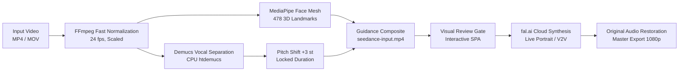

# tBelt Studio

> **Lightweight local video preparation, facial motion tracking, and cloud character synthesis.**

[](LICENSE)
[](https://python.org)
[](https://fal.ai)
[](static/i18n.js)

**tBelt Studio** is an open-source, hybrid pipeline designed for photorealistic character replacement and motion transfer in video. It pairs lightweight, zero-cost local CPU signal processing (FFmpeg, MediaPipe Face Mesh, and Demucs) with enterprise cloud generative diffusion via **fal.ai**.

The entire source audio (vocal stems, music, sound design, and ambience) is preserved and restored into the final export, while character motion, facial expressions, and lip-sync are transferred onto a new identity.

---

## What Makes This Architecture Distinct

Unlike conventional video synthesis pipelines that either demand heavy local GPU workstations (16+ GB VRAM) or rely on expensive, fragmented third-party APIs for basic audio tasks, **tBelt Studio** is architected around strict separation of computational concerns:

1. **Zero External Audio API Costs (100% Local CPU Demucs)**:
   - Vocal isolation runs locally via Demucs (`htdemucs` architecture) directly on CPU.
   - Isolated vocals are frequency-modulated by +3 semitones while retaining sample-accurate duration and syllable timing.
   - No paid cloud APIs are used for stem separation.

2. **Native MediaPipe 478-Point Face Mesh**:
   - Real-time 3D facial landmark calculation using Google's quantized TensorFlow Lite model (`face_landmarker.task`, ~3.6 MB).
   - Adaptive portrait cropping (`x0=0.20*w, cw=0.60*w, ch=0.75*h`) ensures robust facial detection on both portrait and wide cinematic frames.
   - Temporal smoothing across rapid head turns prevents tracking gaps and pipeline crashes.

3. **Unified Cloud Synthesis via fal.ai**:
   - Character diffusion and neural motion transfer are handled through **fal.ai** (`FAL_KEY`).
   - Clean draft-first workflow: validate motion and silhouette on a fast preview before committing to a full 1080p high-definition export.

4. **Production SPA with Real-Time Feedback**:
   - Zero full-page reloads: state changes happen smoothly via client-side routing (`history.pushState`).
   - Live upload tracking via `XMLHttpRequest` with exact byte counts and percentage indicators (`X.X MB / Y.Y MB`).
   - Active session stopwatch (`⏱ mm:ss`) and 4-phase visual milestone indicators.
   - In-memory manifest Set lookup eliminates blind HTTP `HEAD` probing and resolves console 404 errors.

5. **Built-in Bilingual i18n Architecture**:
   - Instant runtime language toggling between Spanish (`es`) and English (`en`) with persisted preferences in `localStorage`.

6. **Decoupled macOS System Daemons**:
   - The application server and Cloudflare Named Tunnel run as managed `LaunchAgents`, requiring zero active terminal windows or background agent tasks.

---

## Workflow Architecture



---

## Resource & Performance Profile

Benchmarked on an entry-level Apple Silicon Mac mini (8 GB unified memory):

| Pipeline Stage | Engine | Execution Time (10s Clip) | Peak RAM Consumption |
|---|---|---|---|
| **Video Normalization** | FFmpeg C-Filters | 2.5 seconds | ~80 MB |
| **Face Mesh Tracking** | MediaPipe (TFLite CPU) | 6.8 seconds | ~150 MB |
| **Vocal Isolation** | Demucs (`htdemucs` CPU) | 16.2 seconds | ~850 MB (peak) |
| **Pitch Modulation** | FFmpeg / Rubber Band | 1.1 seconds | ~40 MB |
| **Total Local Prep** | — | **~26.6 seconds** | **~1.1 GB max** |

The Mac mini remains responsive throughout local execution, leaving over 6 GB of system RAM free.

---

## Quickstart

### Prerequisites
- macOS or Linux
- Python 3.12+
- `ffmpeg`, `sox`, `rubberband`
- A [fal.ai API Key](https://fal.ai/dashboard/keys)

```bash
# macOS installation
brew install ffmpeg sox rubberband python@3.12
```

### Installation

```bash
# 1. Clone the repository
git clone https://github.com/tBeltty/studiotbelt.git
cd studiotbelt

# 2. Create and activate virtual environment
python3.12 -m venv .venv
source .venv/bin/activate
pip install -r requirements.txt

# 3. Configure credentials
cp .env.example .env
# Open .env and insert your FAL_KEY
```

### Running the Application

```bash
# Development server
python -m uvicorn app:app --host 127.0.0.1 --port 8770 --reload

# Open in browser
open http://127.0.0.1:8770
```

---

## Step-by-Step Usage

1. **Step 01 — Upload & Preparation**:
   - Drag and drop your original video clip (up to 30 seconds).
   - Observe instant file verification (size and filename).
   - Click **⚡ 1-Click: Prepare Video**. Watch the real-time upload bar and milestone indicators progress through normalization, MediaPipe mesh tracking, and Demucs stem isolation.
2. **Step 02 — Verification & Review**:
   - Review the prepared motion guide with isolated vocal tracks.
   - Inspect individual audio stems (`vocals.wav`, `vocals-plus3.wav`, `music.wav`).
   - Click **✓ Approve & Continue to Character**.
3. **Step 03 — Character Synthesis**:
   - Upload the reference photo of the new character (face or body).
   - Verify prompt synthesis instructions.
   - Click **✨ 2-Click: Generate Character** to dispatch draft generation to fal.ai.
4. **Step 04 — Master Export**:
   - Inspect the draft preview with pristine original source audio restored.
   - Approve 1080p high-definition upgrade when satisfied.

---

## Project Structure

```
studiotbelt/
├── app.py                  # FastAPI application server and REST endpoints
├── audio_workflow.py       # Demucs vocal separation & pitch shift engine
├── face_mesh.py            # MediaPipe Face Mesh tracking controller
├── mesh_worker.py          # 478 3D landmark extractor with temporal smoothing
├── pipeline.py             # FFmpeg-accelerated video normalization
├── seedance_bridge.py      # fal.ai cloud synthesis adapter and job poller
├── mask_review.py          # Quality gate review state manager
├── static/
│   ├── index.html          # SPA interface with real-time progress dashboard
│   ├── i18n.js             # Bilingual Spanish/English translation engine
│   └── favicon.svg         # Studio vector brand mark
├── docs/
│   └── ARCHITECTURE.md     # In-depth technical architecture specification
├── CHANGELOG.md            # Release history following Keep a Changelog
├── CONTRIBUTING.md         # Contribution guidelines and standards
├── SECURITY.md             # Vulnerability reporting and security posture
├── LICENSE                 # MIT License
└── requirements.txt        # Python dependency manifest
```

---

## License

This project is licensed under the [MIT License](LICENSE).
Copyright (c) 2026 Sirio Berati  
Copyright (c) 2026 tBelt Online (https://tbelt.online)
