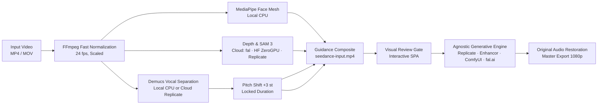

# tBelt Studio

> **Motion-guided character replacement and video recasting with original audio preservation.**

[](LICENSE)
[](https://python.org)
[](providers.py)
[](docs/DEPLOY-WEB.md)
[](static/i18n.js)

**tBelt Studio** is an open-source pipeline for photorealistic character replacement and motion transfer in video. It operates flexibly across two execution models:
- **Hybrid Local-First (Default)**: High-speed local CPU signal processing (FFmpeg normalization, MediaPipe 3D face mesh, Demucs vocal isolation) paired with cloud or local neural synthesis engines.
- **100% Cloud & Web-Only**: Fully containerized ([`Dockerfile`](Dockerfile)) for deployment on free Hugging Face Spaces (CPU Basic tier), Railway, Render, or VPS. Offloads both signal isolation (cloud Demucs API) and volumetric masking (Hugging Face ZeroGPU / fal.ai) to cloud services, running end-to-end in the browser with zero local hardware or software dependencies.

The entire source audio (dialogue, music bed, sound effects) is preserved and remuxed into the final export, while actor movement, facial expression, and lip-sync are transferred onto a new identity.

---

## Core Engineering Highlights

**tBelt Studio** combines lightweight local signal processing with flexible cloud and local neural diffusion models:

1. **Multi-Engine Freedom & Zero Subscription Lock-in**:
   - Dispatch generation across **fal.ai** (Wan 2.2 & MiniMax H3 Max Recast), **Replicate** (serverless GPU-seconds), **ComfyUI** (100% offline self-hosted open weights), or **Enhancor** (Seedance 2.5).
   - Generates without upfront monthly subscription commitments; configure credentials and switch backends directly inside the in-app Settings modal.

2. **Dual-Mode Signal Engine (Hybrid Local-First or Cloud-Only)**:
   - **Local CPU Mode (Zero-Cost Prep)**: All high-latency preparation stages run locally on consumer CPU hardware (benchmarked on 8 GB Apple Silicon Mac mini). Video normalization runs via hardware-accelerated FFmpeg C-filters in under 3 seconds, Demucs (`htdemucs`) separates vocal stems locally, and MediaPipe processes 3D landmarks in real time with ~1.1 GB RAM footprint and zero preparation API billing.
   - **Web-Only / Cloud-Only Mode**: When deployed via Docker to cloud PaaS or free Hugging Face Spaces, preparation gracefully offloads audio isolation to Replicate's Demucs API and volumetric segmentation to Hugging Face ZeroGPU or fal.ai SAM 3, enabling pure browser access without local Python or FFmpeg installation.

3. **Fault-Tolerant Motion & Facial Guidance**:
   - **Adaptive Cropping Geometry**: Centers bounding matrices ($x_0 = 0.20 \cdot W, w = 0.60 \cdot W, h = 0.75 \cdot H$) to maintain high landmark confidence on wide and medium cinematic shots.
   - **Temporal Occlusion Smoothing**: Interpolates landmark matrices across rapid head turns, yaw rotations, and temporary occlusions, guaranteeing continuous tracking without dropping frames.

4. **Studio-Grade Audio Engineering**:
   - Demucs isolates speech and music beds into clean uncompressed PCM stems.
   - Isolated dialogue is frequency-modulated by +3 semitones with duration locking via Rubber Band to eliminate vocal identity bleed while keeping syllable timing and lip-sync intact.
   - Synthesis guidance embeds the modulated audio directly, and the final 1080p master export restores the complete original source mix (dialogue, score, sound effects).

5. **Production SPA & Operator Ergonomics**:
   - Asynchronous upload telemetry via `XMLHttpRequest` with exact byte counts and percentage indicators (`X.X MB / Y.Y MB`).
   - Active session stopwatch (`mm:ss`) and 4-phase milestone tracking (Normalization, Mesh/Depth, Audio Separation, Review Gate).
   - In-memory artifact manifest (`Set.has()`) for O(1) artifact existence verification, eliminating blind HTTP 404 network probing.
   - Bilingual UI with one-click toggling between Spanish (`es`) and English (`en`).

6. **Daemon & Security Hardening**:
   - Thread-safe background execution managed by `concurrent.futures.ThreadPoolExecutor` with graceful lifecycle cleanup.
   - Centralized binary resolution (`find_binary`) automatically locates FFmpeg and Rubber Band paths across macOS `launchd` and Linux `systemd` daemon environments.
   - Strict credential encapsulation: API endpoints mask secrets, and configuration is persisted with `chmod 600` access controls.

---

## Model Requirements & Provider Matrix

Step 03 requires video-to-video character replacement models with full-body identity transfer that accept a driving composite video alongside character reference assets, maintaining original camera framing, cuts, lighting, and motion choreography.

| Provider & Model | Pricing Structure | Estimated Cost (15s Clip) | Best For | Subscription Required? |
|---|---|---|---|---|
| **Replicate (Wan 2.2 / LivePortrait)** | Serverless GPU-seconds (~$0.0005–$0.001/s) | **$0.40 – $0.90 USD** | Scalable cloud rendering & Demucs API | **No** (Pay per second) |
| **Hugging Face Spaces (ZeroGPU)** | Free community GPU quota | **$0.00** | Free SAM 3 & Depth Anything | **No** (Free `HF_TOKEN`) |
| **Enhancor (ByteDance Seedance 2.5)** | Subscription credits (~$0.15–$0.35/draft) | **~$0.25 USD** (in credits) | High-volume production | **Yes** ($45/mo plan) |
| **fal.ai (Wan 2.2 / MiniMax H3 Max)** | Pay-as-you-go ($0.04–$0.45/s) | **$0.60 – $6.75 USD** | Pay-as-you-go test iterations | **No** (Prepaid balance) |
| **ComfyUI Local** | Self-hosted local GPU hardware | **$0.00** | Offline privacy & custom nodes | **No** (Free open weights) |

---

## Workflow Architecture



---

## Resource & Performance Profile

Benchmark tests performed on Apple Silicon M1 (8 GB RAM, 10s test clip):

| Pipeline Stage | Engine | Execution Time (10s Clip) | Peak RAM Consumption |
|---|---|---|---|
| **Video Normalization** | FFmpeg C-Filters | 2.5 seconds | ~80 MB |
| **Face Mesh Tracking** | MediaPipe (TFLite CPU) | 6.8 seconds | ~150 MB |
| **Vocal Isolation** | Demucs (`htdemucs` CPU) | 16.2 seconds | ~850 MB (peak) |
| **Pitch Modulation** | FFmpeg / Rubber Band | 1.1 seconds | ~40 MB |
| **Total Local Prep** | — | **~26.6 seconds** | **~1.1 GB max** |

---

## Quickstart

### Prerequisites
- macOS or Linux
- Python 3.12+
- `ffmpeg`, `rubberband`
- An API key for your chosen video engine (Replicate, Enhancor, or fal.ai) or a local ComfyUI URL.

```bash
# macOS (Homebrew)
brew install ffmpeg rubberband python@3.12

# Ubuntu / Debian
sudo apt update && sudo apt install -y ffmpeg rubberband-cli python3 python3-venv python3-pip
```

### Installation

```bash
# 1. Clone the repository
git clone https://github.com/tBeltty/studiotbelt.git
cd studiotbelt

# 2. Automated setup (creates .venv & installs dependencies)
bash setup.sh

# Or manual setup:
python3.12 -m venv .venv
source .venv/bin/activate
pip install -r requirements.txt
cp .env.example .env
python doctor.py
```

### Running the Application

```bash
# Start studio launcher
bash start.sh
# Or directly via Python:
python launch.py

# Open in browser
open http://127.0.0.1:8770
```

### Setup via Coding Agent

To configure the environment using an agentic coding tool with terminal and filesystem access (Codex, Claude Code, Cursor, Antigravity), provide the following prompt:

```text
Set up this tBelt Studio project. Read docs/SETUP.md and follow it end to end. Detect my OS, install missing prerequisites (Python 3.12+, FFmpeg, Rubber Band, cloudflared) using the supported package manager, create the main virtual environment (.venv), install dependencies, run bash setup-face-mesh.sh for local face mesh tracking if supported, and create .env from .env.example without overwriting existing keys. Run the local tests (python -m unittest discover tests) and environment diagnostics (python doctor.py). Launch the app and its callback-only tunnel via python launch.py on a free localhost port, verify that the UI responds, and report the working URL. Work independently through setup, respecting system permission prompts. Do not submit paid generations. If API keys are missing, launch the UI and indicate which provider keys are pending.
```

The launcher initializes a callback-only Cloudflare Quick Tunnel when no custom webhook is configured. Keep it running alongside the application. The agent references the included [setup guide](docs/SETUP.md). Supply your own provider keys in `.env` and approve required system package installations. Windows users must run inside WSL2 (Ubuntu); launch scripts are included for macOS and Linux.

---

## Web & Cloud Deployment

To run tBelt Studio in the cloud without installing local dependencies:

1. **Hugging Face Spaces (Free)**:
   - Create a new Space at [huggingface.co/new-space](https://huggingface.co/new-space) selecting the **Docker** SDK (**CPU Basic Free** hardware tier).
   - Connect or push this repository.
   - Under Settings -> Secrets, configure `PORT=7860` and your credentials (`REPLICATE_API_TOKEN`, `ENHANCOR_API_KEY`, `FAL_KEY`, or `HF_TOKEN`).
2. **PaaS Providers (Railway, Render, Google Cloud Run)**:
   - Connect your GitHub repository. The included `Dockerfile` automatically builds and serves the application.
3. **VPS Server with Docker**:
   ```bash
   docker build -t studiotbelt .
   docker run -d -p 8770:8770 --env-file .env studiotbelt
   ```
4. **100% Cloud Processing (Zero Local Compute)**:
   - **Audio separation**: Configure `REPLICATE_API_TOKEN` to execute Demucs on Replicate GPU infrastructure.
   - **Depth and masks**: Use `huggingface` (free ZeroGPU via `HF_TOKEN`), `replicate`, or `fal`.
   - **Character synthesis**: Replicate, Enhancor, or fal.ai.

Refer to the complete technical guide in [docs/DEPLOY-WEB.md](docs/DEPLOY-WEB.md).

---

## Command Line Interface (CLI)

The repository provides `workflow.py` for headless terminal execution and autonomous agent pipelines:

```bash
# 1. Prepare video (depth, face mesh, or depth+mesh)
python workflow.py prepare path/to/source.mp4 --mode depth --provider auto
# Output: JOB: 8e5f2a1b4c3d... (32-character local job ID)

# 2. Check job status and obtain quality fingerprint
python workflow.py status <JOB_ID>

# 3. Quality review gate (approve current motion/mask artifacts)
python workflow.py review <JOB_ID> --approve --fingerprint <HASH> --note "Visual QA verified"

# 4. Submit character recast draft (supports --prompt string or --prompt-file)
python workflow.py submit <JOB_ID> --prompt "A cinematic portrait of the character" --reference path/to/character.png
# Or with multiple character references:
python workflow.py submit <JOB_ID> --prompt-file prompt.txt --reference char1.png --second-reference char2.png

# 5. Upgrade draft to high-definition 1080p
python workflow.py hd <JOB_ID>

# 6. Resume pending or saved requests without re-paying
python workflow.py resume <JOB_ID>
python workflow.py resume <JOB_ID> --hd
```

---

## Step-by-Step Usage (Web UI)

1. **Step 01 — Upload & Preparation**:
   - Drag and drop your original video clip (up to 30 seconds).
   - Observe instant file verification (size and filename).
   - Click **Prepare Video**. Watch the real-time upload bar and milestone indicators progress through normalization, MediaPipe mesh tracking, and Demucs stem isolation.
2. **Step 02 — Verification & Review**:
   - Review the prepared motion guide with isolated vocal tracks.
   - Inspect individual audio stems (`vocals.wav`, `vocals-plus3.wav`, `music.wav`).
   - Click **Approve & Continue to Character**.
3. **Step 03 — Character Synthesis**:
   - Upload the reference photo of the new character (face or body).
   - Verify prompt synthesis instructions.
   - Select your active generative engine (Replicate, Enhancor, ComfyUI, or fal.ai).
   - Click **Generate Character** to dispatch draft generation.
4. **Step 04 — Master Export**:
   - Inspect the draft preview with pristine original source audio restored.
   - Approve 1080p high-definition upgrade when satisfied.

---

## Project Structure

```
studiotbelt/
├── app.py                  # FastAPI application server and REST endpoints
├── launch.py               # Application launcher with automatic port & tunnel handling
├── doctor.py               # Environment and dependency diagnostic utility
├── workflow.py             # Headless CLI workflow manager
├── audio_workflow.py       # Demucs vocal separation & pitch shift engine
├── face_mesh.py            # MediaPipe Face Mesh tracking controller
├── mesh_worker.py          # 478 3D landmark extractor with temporal smoothing
├── pipeline.py             # FFmpeg-accelerated video normalization & vision pipeline
├── providers.py            # Multi-provider dispatch & settings configuration
├── seedance_bridge.py      # Agnostic cloud synthesis adapter (Replicate, Enhancor, fal.ai)
├── mask_review.py          # Quality gate review state manager
├── static/
│   ├── index.html          # SPA interface with real-time progress dashboard
│   ├── i18n.js             # Bilingual Spanish/English translation engine
│   └── favicon.svg         # Studio vector brand mark
├── docs/
│   ├── ARCHITECTURE.md     # In-depth technical architecture specification
│   ├── DEPLOY-WEB.md       # Docker and cloud deployment guide (ZeroGPU, Hugging Face, VPS)
│   └── SETUP.md            # Local environment installation walkthrough
├── CHANGELOG.md            # Release history following Keep a Changelog
├── CONTRIBUTING.md         # Contribution guidelines and standards
├── SECURITY.md             # Vulnerability reporting and security posture
├── LICENSE                 # MIT License
└── requirements.txt        # Python dependency manifest
```

---

## License & Third-Party Notices

This project is licensed under the [MIT License](LICENSE).  
Copyright (c) 2026 tBeltty (https://tbelt.online)

Third-party components, dependencies, and upstream research notices are documented in [THIRD-PARTY.md](THIRD-PARTY.md).
