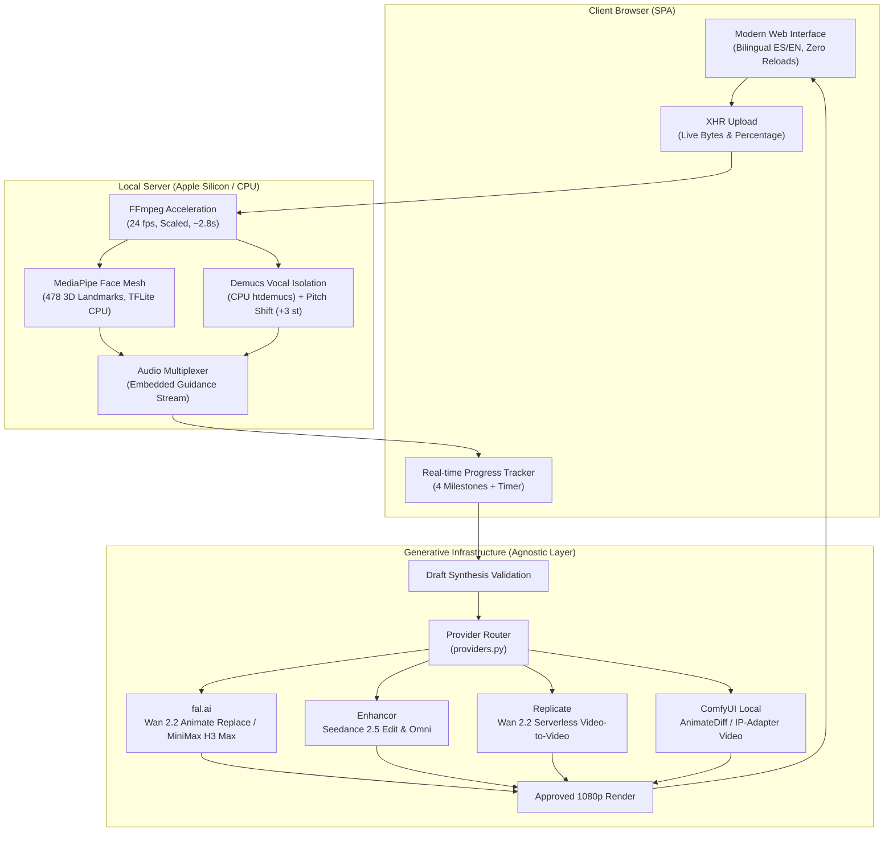

# System Architecture & Technical Specifications

**tBelt Studio** (`studiotbelt`) is an automated system for video character synthesis and motion transfer. It combines local CPU-efficient signal processing (computer vision and digital audio) with cloud-accelerated neural diffusion models.

---

## 1. Architectural Philosophy: Division of Labor

The system decouples processing stages based on computational efficiency between consumer CPU hardware and cloud GPU clusters:

1. **Local CPU (Preparation & Signal Isolation):**
   - **Video Normalization:** Frame rate adjustment to 24 fps and downscaling via FFmpeg native C-filters.
   - **Facial Landmark Mesh:** 478 3D points calculated in real time using Google MediaPipe FaceLandmarker via TensorFlow Lite CPU inference.
   - **Audio Separation & Modulation:** Local Demucs (`htdemucs`) isolates vocals and instrumental tracks. Vocals are pitch-shifted +3 semitones while retaining identical temporal alignment.
   - **Resource Footprint:** Maximum RAM peak of ~1.1 GB, allowing smooth execution on low-memory devices (such as entry-level Mac mini 8GB).

2. **Generative Synthesis (Provider-Agnostic Abstraction Layer):**
   - The preparation stage yields a normalized guidance video `seedance-input.mp4` with pitched audio.
   - The character generation layer is decoupled into `providers.py`, allowing dynamic routing to:
     - **fal.ai**: Wan 2.2 Animate Replace ($0.04-$0.08/s, budget pay-as-you-go) and MiniMax H3 Max Recast ($0.30-$0.45/s, cinematic 1080p).
     - **Enhancor**: Seedance 2.5 Edit & Omni motion transfer and facial identity preservation ($45/mo API plan).
     - **Replicate**: Serverless Wan 2.2 video-to-video execution billed by GPU-seconds.
     - **ComfyUI**: Self-hosted local instances for fully offline, free workflows.
   - Credentials and engine selection are managed dynamically via `/api/settings` and stored securely with `chmod 600`.

---

## 2. Facial Landmark & Motion Guidance

### Dynamic Cropping Geometry
MediaPipe's neural model was optimized on portrait-framing datasets. In wide or cinematic video footage, passing raw 1080p frames often reduces detection confidence. The engine applies an adaptive bounding box:

$$\text{Crop} = \left[ x_0 = 0.20 \cdot W, \, y_0 = 0, \, w = 0.60 \cdot W, \, h = 0.75 \cdot H \right]$$

### Temporal Occlusion Smoothing
During rapid head turns, yaw rotations, or brief downward glances, detection confidence can drop momentarily. Instead of terminating execution with a tracking fault, the landmark processor carries forward the previous valid landmark matrix and linearly interpolates coordinates until re-acquisition, guaranteeing uninterrupted guidance frames.

### Multi-Person Architectural Limitation on Local CPU
The local MediaPipe FaceLandmarker processor is mathematically constrained to a single bounding crop:
$$\text{Crop} = \left[ x_0 = 0.20 \cdot W, \, y_0 = 0, \, w = 0.60 \cdot W, \, h = 0.75 \cdot H \right]$$

When two or more subjects share the frame (e.g., dual interviews, rap duos, dialog scenes):
- The single-crop window cannot encapsulate both faces simultaneously.
- Landmark tracking frequently oscillates between subjects across cuts, causing severe jitter or completely abandoning the secondary character.
- **Resolution**: Multi-person footage requires full-frame semantic segmentation (Option 1: `fal-ai/sam-3/video` or Option 2: `linoyts/SAM3-Video` on Hugging Face Spaces), which extracts pixel-level masks for all bodies and faces across the entire 1920×1080 canvas without cropping.

### Step 01 Preparation Mode Comparison

| Mode | Engine | Cost | Multi-Person? | Latency | Infrastructure |
|---|---|---|---|---|---|
| **Cloud SAM 3 + Depth** | `fal-ai/sam-3/video` + `fal-ai/depth-anything-video` | **~$0.017 USD** | ✅ Yes (Full frame) | ~15–20s | Serverless GPUs |
| **Free Cloud Spaces** | `linoyts/SAM3-Video` + `depth-anything/Video-Depth-Anything` | **$0.00 (Free)** | ✅ Yes (Full frame) | Variable (Queue) | HF ZeroGPU |
| **Local Face Mesh** | MediaPipe TFLite (CPU) via `setup-face-mesh.sh` | **$0.00 (Free)** | ❌ No (Single speaker) | ~6–8s | Local Mac CPU |

---

## 3. Audio Engineering: Demucs + Pitch Shift

1. **Vocal Isolation:** The source audio is extracted as uncompressed PCM WAV and processed through Demucs (`htdemucs` architecture), generating:
   - `vocals.wav` (Clean isolated speech/vocals)
   - `music.wav` (Isolated instrumental/backing track)
2. **Frequency Shift (+3 Semitones):** The vocal stem is frequency-shifted by +3 semitones without altering speed or duration. This modifies acoustic characteristics to avoid identity bleed while keeping syllable timing and lip-sync alignment locked.
3. **Guidance Multiplexing:** The shifted vocal track is re-muxed into `seedance-input.mp4`. No standalone audio files are sent to the synthesis API.
4. **Master Restoration:** When the generative model outputs the synthesized character video, its raw audio track is stripped and replaced with the pristine original uncompressed source audio.

---

## 4. Frontend & Network State Architecture

### Zero-Reload SPA Flow
The frontend avoids traditional form submissions and page reloads. When a video file is dispatched:
1. `XMLHttpRequest.upload.onprogress` tracks network transfer (0% – 30%), rendering exact byte counts.
2. The URL updates unobtrusively using `history.pushState(null, '', '/?job=' + jobId)`.
3. An active session stopwatch begins, counting elapsed wall-clock seconds.

### In-Memory Artifact Manifest
To prevent browser console pollution (404 errors), the backend `/jobs/{id}` response includes a `files: [...]` payload. Client-side existence checks use an in-memory `Set.has(filename)` lookup, eliminating redundant HTTP `HEAD` probing.

---

## 5. Security & Daemon Management

- **Zero Plain-Text Exposure:** API credentials (`FAL_KEY`, `ENHANCOR_API_KEY`, `REPLICATE_API_TOKEN`) are never exposed via client JSON payloads. The settings API exposes only a Boolean configuration status, and values are persisted locally in `.env` with strict `chmod 600` access controls.
- **Persistent Service Architecture:** The API server (`uvicorn`) and secure Cloudflare Tunnel (`cloudflared`) run as isolated macOS `LaunchAgents`, decoupled from terminal shells.
