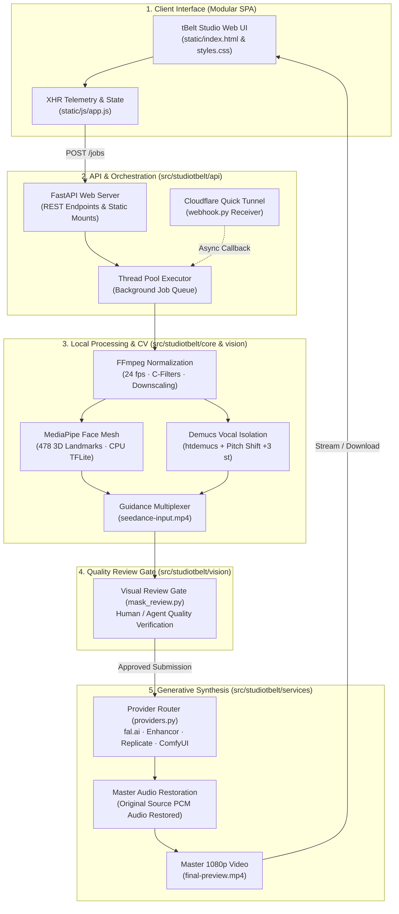
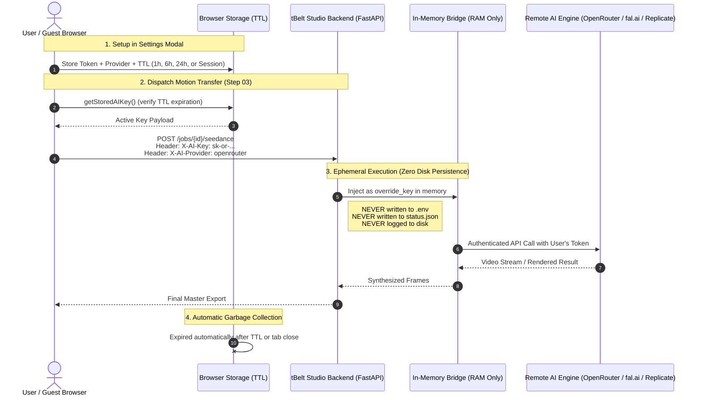

# System Architecture & Technical Specifications

**tBelt Studio** (`studiotbelt`) is an automated system for video character synthesis and motion transfer. It combines local CPU-efficient signal processing (computer vision and digital audio) with cloud-accelerated neural diffusion models.

---

## 1. Architectural Philosophy: Division of Labor

The system decouples processing stages based on computational efficiency between consumer CPU hardware and cloud GPU clusters:



1. **Local CPU (Preparation & Signal Isolation):**
   - **Video Normalization:** Frame rate adjustment to 24 fps and downscaling via FFmpeg native C-filters.
   - **Facial Landmark Mesh:** 478 3D points calculated in real time using Google MediaPipe FaceLandmarker via TensorFlow Lite CPU inference (`src/studiotbelt/vision/face_mesh.py`).
   - **Audio Separation & Modulation:** Local Demucs (`htdemucs`) isolates vocals and instrumental tracks. Vocals are pitch-shifted +3 semitones while retaining identical temporal alignment (`src/studiotbelt/core/audio_workflow.py`).
   - **Resource Footprint:** Maximum RAM peak of ~1.1 GB, allowing execution on low-memory hardware (benchmark tests on Apple Silicon M1 with 8 GB RAM).

2. **Generative Synthesis (Provider-Agnostic Abstraction Layer):**
   - The preparation stage yields a normalized guidance video `seedance-input.mp4` with pitched audio.
   - The character generation layer is decoupled into `src/studiotbelt/services/providers.py`, allowing dynamic routing to:
     - **Replicate**: Serverless Wan 2.2 video-to-video execution and LivePortrait billed by GPU-seconds.
     - **Enhancor**: ByteDance Seedance 2.5 Edit & Omni motion transfer and facial identity preservation.
     - **ComfyUI**: Self-hosted local instances for fully offline workflows.
     - **fal.ai**: Wan 2.2 Animate Replace and MiniMax H3 Max Recast.
   - Credentials and engine selection are managed dynamically via `/api/settings` and stored securely with `chmod 600`.

---

## 2. Facial Landmark & Motion Guidance

### Dynamic Cropping Geometry
MediaPipe's neural model was optimized on portrait-framing datasets. In wide or cinematic video footage, passing raw 1080p frames often reduces detection confidence. The engine applies an adaptive bounding box:

$$\text{Crop} = \left[ x_0 = 0.20 \cdot W, \, y_0 = 0, \, w = 0.60 \cdot W, \, h = 0.75 \cdot H \right]$$

### Temporal Occlusion Smoothing
During rapid head turns, yaw rotations, or brief downward glances, detection confidence can drop momentarily. Instead of terminating execution with a tracking fault, the landmark processor carries forward the previous valid landmark matrix and linearly interpolates coordinates until re-acquisition, guaranteeing uninterrupted guidance frames.

### Multi-Subject Limitations
The local MediaPipe FaceLandmarker processor evaluates a single bounding crop:
$$\text{Crop} = \left[ x_0 = 0.20 \cdot W, \, y_0 = 0, \, w = 0.60 \cdot W, \, h = 0.75 \cdot H \right]$$

Because tracking is constrained to one face per frame, multi-subject scenes require full-frame semantic segmentation (SAM 3).

### Step 01 Preparation Mode Comparison

| Mode | Engine | Cost | Multi-Person? | Latency | Infrastructure |
|---|---|---|---|---|---|
| **Cloud SAM 3 + Depth** | `fal-ai/sam-3/video` + `fal-ai/depth-anything-video` | **~$0.017 USD** | Yes (Full frame) | ~15–20s | Serverless GPUs |
| **Free Cloud Spaces** | `linoyts/SAM3-Video` + `depth-anything/Video-Depth-Anything` | **$0.00 (Free)** | Yes (Full frame) | Variable (Queue) | HF ZeroGPU |
| **Local Face Mesh** | MediaPipe TFLite (CPU) via `setup-face-mesh.sh` | **$0.00 (Free)** | No (Single speaker) | ~6–8s | Local CPU |

---

## 3. Audio Engineering: Demucs + Pitch Shift

1. **Vocal Isolation:** The source audio is extracted as uncompressed PCM WAV and processed through Demucs (`htdemucs` architecture), generating:
   - `vocals.wav` (Clean isolated speech/vocals)
   - `music.wav` (Isolated instrumental/backing track)
2. **Frequency Shift (+3 Semitones):** The vocal stem is frequency-shifted by +3 semitones without altering speed or duration. This modifies acoustic characteristics to avoid identity bleed while keeping syllable timing and lip-sync alignment locked.
3. **Guidance Multiplexing:** The shifted vocal track is re-muxed into `seedance-input.mp4`. No standalone audio files are sent to the synthesis API.
4. **Master Restoration:** When the generative model outputs the synthesized character video, its raw audio track is stripped and replaced with the pristine original uncompressed source audio.

---

## 4. Frontend & Network State Architecture

### Zero-Reload SPA Flow
The frontend avoids traditional form submissions and page reloads. When a video file is dispatched:
1. `XMLHttpRequest.upload.onprogress` tracks network transfer (0% – 30%), rendering exact byte counts.
2. The URL updates unobtrusively using `history.pushState(null, '', '/?job=' + jobId)`.
3. An active session stopwatch begins, counting elapsed wall-clock seconds.

### In-Memory Artifact Manifest
To prevent browser console pollution (404 errors), the backend `/jobs/{id}` response includes a `files: [...]` payload. Client-side existence checks use an in-memory `Set.has(filename)` lookup, eliminating redundant HTTP `HEAD` probing.

---

## 5. Security Architecture: Bring Your Own Token (BYOK / BYOT)

**tBelt Studio** introduces an ephemeral, zero-trust credential model called **Bring Your Own Token (BYOT / BYOK)**. It is designed to solve the two biggest friction points in generative AI tooling: **predatory subscription lock-in** and **credential exposure on shared servers**.



### 1. The Core Philosophy ("What is Behind It")

1. **Eliminating the SaaS Subscription Tax**:
   - Traditional AI video tools force users into recurring \$20–\$50/month subscription tiers with artificial credit limits, markups of 200%–500% over raw inference costs, and monthly reset traps.
   - BYOT connects directly to wholesale developer APIs (OpenRouter, fal.ai, Replicate, Enhancor). A 15-second Wan 2.1/3.0 motion transfer costs **\$0.20 – \$0.50 USD** in actual GPU-seconds, billed directly to the user's existing developer account with zero intermediary markup.

2. **Zero-Trust Multi-Tenant & Guest Sharing**:
   - In agency, studio, or team environments, tBelt Studio is often hosted on a shared local network, VPS, or cloud container.
   - If a host had to save user keys in the server's `.env` or disk database, guest users would risk their funded API credits being captured or misused by the server admin.
   - BYOT ensures that **no guest key is ever persisted to server storage**. The host machine operates purely as a compute router for free preprocessing (FFmpeg normalization, Demucs stem isolation, MediaPipe face tracking), while the guest's own account finances the neural synthesis.

---

### 2. The Wire Protocol & Execution Lifecycle

1. **Client-Side Key Vault & TTL Isolation**:
   - The user inputs their API token into the **Settings** modal, selecting a Time-To-Live (TTL):
     - **Session Only (`0h`)**: Written to `sessionStorage`. Key is purged the instant the browser tab is closed.
     - **Configured Duration (`1h`, `6h`, `24h`)**: Written to `localStorage` with a timestamp `expiresAt: Date.now() + hours * 3600000`.
   - On every client action, `getStoredAIKey()` validates `Date.now() > expiresAt`. Expired keys are instantly removed from browser storage before any network request occurs.

2. **Per-Request Header Injection**:
   - When submitting Step 03 character synthesis, `static/js/app.js` extracts the unmasked active key and transmits it over HTTPS:
     ```http
     POST /jobs/{ident}/seedance HTTP/1.1
     Host: studio.tbelt.online
     X-AI-Key: sk-or-v1-xxxxxxxxxxxxxxxxxxxx
     X-AI-Provider: openrouter
     Content-Type: multipart/form-data
     ```

3. **In-Memory Injection on Backend**:
   - FastAPI parses the headers via declarative parameter injection:
     ```python
     @app.post('/jobs/{ident}/seedance')
     def seedance(
         ident: str,
         prompt: str = Form(...),
         x_ai_key: str | None = Header(None, alias="X-AI-Key"),
         x_ai_provider: str | None = Header(None, alias="X-AI-Provider"),
     ):
         ...
         submit(folder, prompt, *paths, override_key=x_ai_key, override_provider=x_ai_provider)
     ```
   - The key exists solely as an ephemeral Python function argument in memory (`override_key`).
   - The key is **strictly barred from disk serialization**: neither `status.json`, `generation.json`, nor log files record the credential. Once the HTTP request to the external provider is initiated, the memory reference falls out of scope.

---

### 3. Server Configuration Hierarchy

When a job is dispatched, `src/studiotbelt/services/seedance_bridge.py` evaluates credentials in strict order of precedence:

| Priority | Source | Scope | Persistence | Best For |
|:---:|---|---|---|---|
| **1 (Highest)** | Client `X-AI-Key` Header | Single Request | Ephemeral (RAM only) | Guests, collaborators, per-job testing |
| **2** | Host `.env` (`OPENROUTER_API_KEY`, etc.) | Instance-wide | Local disk (`chmod 600`) | Dedicated server owners |
| **3 (Fallback)** | ComfyUI Local Instance | Offline LAN | None required | 100% private zero-cost open weights |

If the server host has no keys configured in `.env`, the instance operates in **Pure Guest Mode**, fully usable by anyone who provides their own API token without incurring costs for the server maintainer.

---

## 6. Infrastructure & Daemon Management

- **Zero Plain-Text Exposure:** Host credentials (`FAL_KEY`, `ENHANCOR_API_KEY`, `REPLICATE_API_TOKEN`, `OPENROUTER_API_KEY`) are protected under `chmod 600`. The `/api/settings` endpoint never exposes raw secret values over JSON, returning only boolean presence masks.
- **Dedicated Runtime Isolation:** All server and tunnel logs are directed to `logs/` (`logs/server.log`, `logs/tunnel.log`), strictly isolated from the repository root and ignored by version control.
- **Persistent Service Architecture:** The API server (`studiotbelt.cli.launch`) and secure Cloudflare Tunnel (`cloudflared`) run as isolated macOS `LaunchAgents` (`online.tbelt.studio-server` and `online.tbelt.studio-tunnel`), ensuring seamless background uptime and automatic recovery after system reboots.
